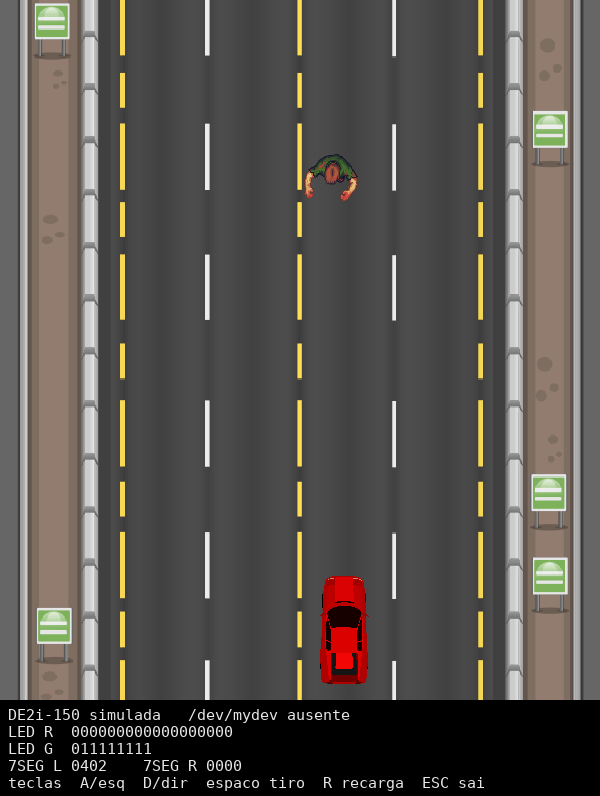
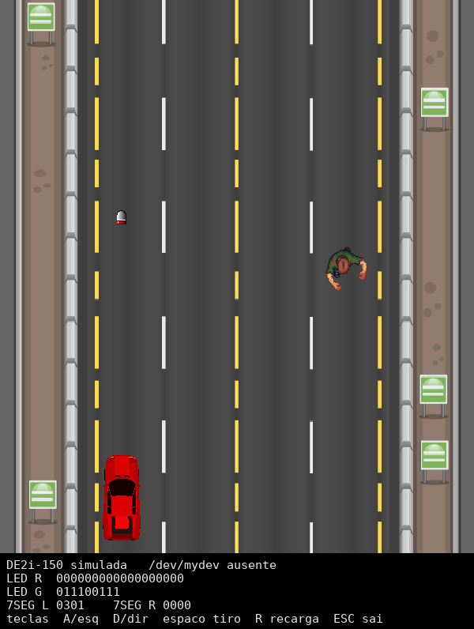
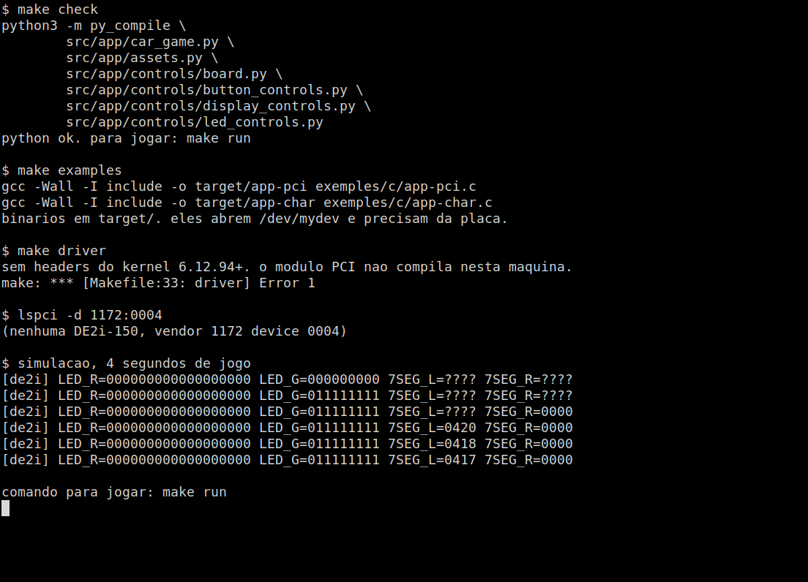

# Jogo do carro na DE2i-150

Jogo em Python (pygame) em que um carro anda numa pista, desvia de zumbis e atira. Na disciplina ele era jogado pelos botões da placa Terasic DE2i-150. Os LEDs e os displays de 7 segmentos da placa mostram a rodada, a munição, a vida e a pontuação.

O acesso à placa passa por um driver PCI de caractere. Ele publica o dispositivo `/dev/mydev`. O jogo manda `ioctl` nesse arquivo e em seguida lê ou escreve 4 bytes. Sem a placa, o mesmo jogo abre com o teclado e desenha numa faixa o que iria para os LEDs e para os displays.

## Disciplina

IF817, Interface Hardware-Software (IHS), no Centro de Informática da UFPE, período 2023.2.

O grupo commitou de 14 a 19 de março de 2024. A IF817 de 2023.2 ia até 20/03/2024: começou em 23/10/2023, parou no recesso e voltou em 29/01/2024. A oferta de 2024.1 começa em 15/04/2024. O ponto de partida do repositório é o layout da disciplina, [mfbsouza/ihs-project-layout](https://github.com/mfbsouza/ihs-project-layout), cujo README já chama o projeto de IF817 (IHS). O arquivo `src/app/README.md` repete o nome da disciplina.

## Prints

Jogo aberto sem a placa. O zumbi desce a pista, o carro está embaixo, e a faixa preta é o estado da DE2i-150 (LEDs e 7 segmentos). Vida 20 e 4 munições no display da esquerda (`0420`), pontuação 0 na direita.



O carro foi para a esquerda e atirou. A munição no display esquerdo e nos LEDs verdes mudou.



`make check`, compilação dos exemplos em C, tentativa de gerar o módulo do kernel e o log da simulação. Nesta máquina não há headers do kernel 6.12.94+ e o `lspci` não acha o dispositivo PCI `1172:0004`.



## Como funciona

O loop do jogo está em `src/app/car_game.py`. A cada quadro ele:

1. Monta o padrão dos LEDs vermelhos com a rodada e o dos verdes com a munição (`src/app/controls/led_controls.py`).
2. Escreve a pontuação no display direito e a vida junto com a munição no display esquerdo (`src/app/controls/display_controls.py`). Os dígitos são os códigos de 7 segmentos.
3. Lê os botões (`src/app/controls/button_controls.py`). O valor vem ativo em nível baixo, como na placa: 7 esquerda, 11 tiro, 13 recarga, 14 direita.
4. Move o carro, cria o tiro se ainda houver munição, anda os zumbis e confere colisão. Zumbi encostando no carro tira 2 de vida. Zumbi que atravessa a tela tira 1. Cada zumbi derrubado soma 1 ponto. São 10 rodadas, com mais zumbis nas últimas. A munição começa em 4 e só recarrega quando acaba.

Os números de `ioctl` estão em `include/ioctl_cmds.h` (`_IO('a', ...)`). No Python eles aparecem como 24929 a 24934.

O driver `driver/pci/de2i-150.c` atende o PCI ID `1172:0004` (Altera/Intel, a ponte da DE2i-150), mapeia a BAR0 e, no `ioctl`, aponta a leitura ou a escrita para um offset:

| periférico        | comando        | offset |
|-------------------|----------------|--------|
| chaves            | `RD_SWITCHES`  | 0xC020 |
| botões            | `RD_PBUTTONS`  | 0xC060 |
| display esquerdo  | `WR_L_DISPLAY` | 0xC040 |
| display direito   | `WR_R_DISPLAY` | 0xC000 |
| LEDs vermelhos    | `WR_RED_LEDS`  | 0xC080 |
| LEDs verdes       | `WR_GREEN_LEDS`| 0xC100 |

O `read` e o `write` do dispositivo usam o ponteiro escolhido pelo último `ioctl`. Por isso o jogo sempre faz `ioctl` e depois lê ou escreve.

`driver/char/dummy.c` é o exemplo de driver de caractere que veio no layout. O jogo não usa esse módulo.

`src/menu_code.py` está vazio. `src/P15_0157_a5_rgb.png` não entra no jogo.

## Como compilar e rodar

Dependências de usuário: Python 3, pygame, gcc e make. No Debian/Ubuntu:

```bash
sudo apt install python3-pygame gcc make
```

Na raiz do repositório:

```bash
make            # confere a sintaxe do jogo
make examples   # compila exemples/c para target/
make run        # abre o jogo
```

`./setup.sh` faz o mesmo check, compila os exemplos e tenta o driver. Sem a placa ele só indica o `make run`.

Teclas, no lugar dos quatro botões:

| tecla | botão da placa |
|---|---|
| A ou seta esquerda | esquerda |
| D ou seta direita | direita |
| espaço, W ou seta cima | tiro |
| R, S ou seta baixo | recarga |
| ESC | fecha |

`DE2I_MOCK=1 make run` força o teclado mesmo se `/dev/mydev` existir.

Os binários `target/app-pci` e `target/app-char` são os exemplos em C do layout. Eles abrem um arquivo de dispositivo passado na linha de comando e precisam da placa (ou de outro módulo que crie esse arquivo). Não fazem parte da simulação.

### O que precisa da placa de verdade

- A DE2i-150 encaixada, com o projeto da FPGA que responde nesses offsets da BAR0 e com o dispositivo PCI `1172:0004` visível no `lspci`.
- Headers do kernel iguais ao kernel que está rodando (`/lib/modules/$(uname -r)/build`). Sem isso o `make driver` não gera o `.ko`. O fonte já trata a mudança do `class_create` a partir do Linux 6.4; nesta máquina o kernel é 6.12.94+ e os headers não estão instalados, então o módulo não chegou a ser compilado.
- Com a placa e os headers: `make driver`, `sudo insmod driver/pci/de2i-150.ko` e `sudo chmod 666 /dev/mydev`. Aí o jogo deixa o teclado de lado e usa o hardware. Comandos de módulo estão em `docs/commands.md`.

A simulação não carrega módulo nenhum. Ela só guarda LEDs, displays e botões dentro do processo do jogo.

O `make all` antigo continua no Makefile para o caso de alguém colocar código C, C++ ou Assembly em `src/`. Hoje não há esses arquivos. O alvo padrão é o `make` do jogo.

## Equipe

`git shortlog -sn --all`:

```
    43	mfbsouza
    11	Vitor Manoel
    10	Matheus Souza
    10	Rafael
     9	Rafael-Azvedo
     3	vitork15
     2	Mend25
     1	Felipe Lin
```

Matheus Souza e mfbsouza são a mesma pessoa. Esses 53 commits, mais o de Felipe Lin em `docs/commands.md`, são o layout da disciplina (2022 e o merge de março de 2023). O fork deste grupo é de 14/03/2024, na conta [iianmelo](https://github.com/iianmelo).

Daqui para a frente, 35 commits, até 19/03/2024:

- Rafael Azvedo (os nomes Rafael e Rafael-Azvedo, GitHub Azvedo, `raas@cin.ufpe.br`): 19 commits. Trouxe o jogo para o repositório, organizou `src/`, fez a leitura dos botões e fechou os offsets do driver PCI e o exemplo `exemples/python/app-pci.py`.
- Vitor Manoel (Vitor Manoel e vitork15): 14 commits. Displays de 7 segmentos, LEDs, rodadas, vida do carro, munição e o encaixe desses controles em `src/app/controls/`.
- Victor Mendonça (Mend25): 2 commits. Criou `src/menu_code.py` (o arquivo ficou vazio) e mexeu em vida, dano e atraso da recarga.
- Ian Melo (iianmelo) não aparece no `shortlog`. Nenhum commit está no nome dele, então o histórico não mostra parte do código atribuída a ele.
